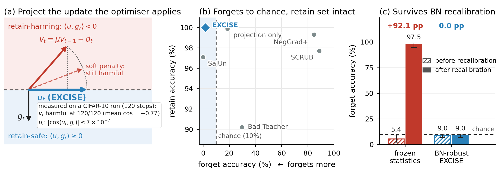
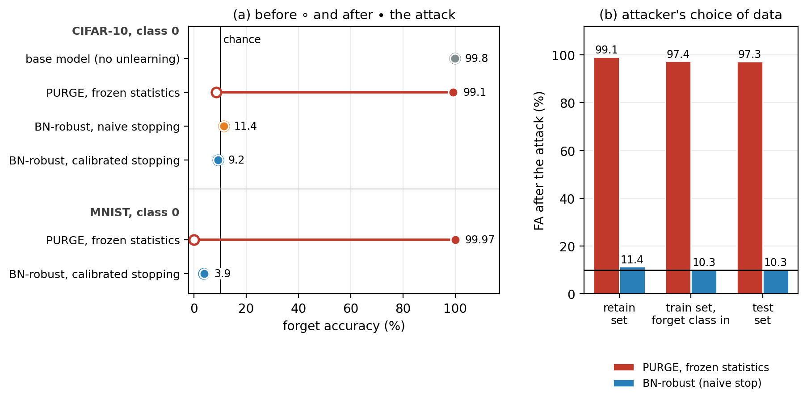

# EXCISE

**Provably Retain-Safe Machine Unlearning via Gradient Projection**

[](https://www.python.org/downloads/)
[](https://pytorch.org/)
[](LICENSE)

EXCISE removes a class from a trained network while protecting what the network
should keep. It adapts A-GEM gradient projection from continual learning: before
every step, the update the optimiser is about to apply, momentum included, is
projected onto the half-space where it cannot increase the retain loss to first
order. The resulting per-step retain-safety guarantee holds for the optimiser
that actually runs, not for a momentum-free surrogate.

**Paper:** [`paper/excise_tmlr.pdf`](paper/excise_tmlr.pdf) · source [`paper/excise_tmlr.tex`](paper/excise_tmlr.tex)

> EXCISE was called PURGE in earlier versions of this work. Checkpoint files,
> result folders and the method labels inside the CSVs keep that name
> (`purge_*.pth`, `purge`), so the recorded results and the scripts still match.

<p align="center">
  
</p>

---

## Highlights

| | |
|---|---|
| **Exact per-step retain safety** | ⟨u<sub>t</sub>, g<sub>r</sub>⟩ ≥ 0 for the post-momentum update actually applied (Theorem 1), and logged at every step of real runs |
| **Momentum is not incidental** | removing it to simplify the analysis stops forgetting on five of six datasets (e.g. MNIST forget accuracy 95.9%) |
| **Six datasets, 31 forgetting tasks** | CIFAR-10, CIFAR-100, MNIST, SVHN, STL-10, PathMNIST with ResNet-18; ViT-B/16 on CIFAR-10 |
| **BatchNorm: attacked, then fixed** | recomputing BatchNorm statistics undoes forgetting learned against frozen ones (ΔF = +98.4pp); BN-robust EXCISE keeps forget accuracy at or below chance under that attack on all ten CIFAR-10 classes and on MNIST |

---

## Install

```bash
git clone <repository-url> la_purge && cd la_purge
python -m venv .venv && source .venv/bin/activate
pip install -r requirements.txt
```

A CUDA GPU is recommended. Datasets download to `./data` on first use
(PathMNIST through the `medmnist` package).

## Quick start

```bash
# 1. Base model: ImageNet-pretrained ResNet-18 fine-tuned on CIFAR-10
#    -> checkpoints/base_cifar10_resnet18.pth
python experiments/train_base_all.py --datasets cifar10 --data_dir ./data --save_dir ./checkpoints

# 2. Forget CIFAR-10 class 0 with EXCISE
python run.py --config configs/cifar10_kl_retain.yaml \
  --checkpoint ./checkpoints/base_cifar10_resnet18.pth \
  --data_dir ./data --save_dir ./checkpoints
```

`--forget_class k` forgets another class, and `configs/` holds one configuration
per dataset. The run prints test, forget and retain accuracy (TA / FA / RA),
membership-inference AUROC, and saves the unlearned checkpoint.

### BN-robust EXCISE

On a BatchNorm backbone, add these flags to keep the BatchNorm statistics
consistent with the weights throughout unlearning (§6.5 and Appendix F.6 of the
paper):

```bash
python run.py --config configs/cifar10_kl_retain.yaml \
  --checkpoint ./checkpoints/base_cifar10_resnet18.pth \
  --data_dir ./data --save_dir ./checkpoints \
  --bn_robust exact --bn_recal_samples 512 --bn_recal_persistent \
  --bn_calibrated_stop --bn_stop_recal_samples 10240 --restore_best_epoch --epochs 25
```

### Attack a checkpoint with BatchNorm recalibration

```bash
python experiments/bn_illusion_attack.py --dataset cifar10 --forget_class 0 \
  --data_dir ./data --checkpoints excise:<unlearned.pth> [--recal_on train|test]
```

The attack resets the BatchNorm statistics and recomputes them on the retain set
(or, with `--recal_on`, on data of the attacker's choosing), checks that no
weight changed, and reports forget accuracy before and after.

---

## Results

### Cross-dataset (Table 3)

Mean ± sample std over classes × seeds (three seeds per task, one seed per class
on CIFAR-100). Chance = 100/K% is the level a fully unlearned model
must reach.

| Dataset | tasks | chance | TA | FA ↓ | RA | MIA |
|---------|------:|-------:|----|------|----|-----|
| CIFAR-10  | 1 | 10.0% | 86.13 ± 0.02 | **1.87** ± 0.25 | 100.00 ± 0.00 | 0.529 ± 0.001 |
| MNIST     | 10 | 10.0% | 90.00 ± 0.64 | **6.17** ± 2.81 | 99.49 ± 0.04 | 0.497 ± 0.009 |
| SVHN      | 1 | 10.0% | 89.69 ± 0.02 | **5.75** ± 0.17 | 97.26 ± 0.01 | 0.525 ± 0.001 |
| PathMNIST | 9 | 11.1% | 80.96 ± 5.39 | **5.82** ± 3.42 | 98.88 ± 0.31 | 0.483 ± 0.084 |
| STL-10    | 1 | 10.0% | 85.15 ± 0.06 | **1.73** ± 0.95 | 98.87 ± 0.05 | 0.488 ± 0.008 |
| CIFAR-100 | 9 | 1.0% | 75.50 ± 0.68 | **1.27** ± 0.39 | 91.32 ± 0.94 | 0.490 ± 0.043 |

STL-10 and CIFAR-100 are shown at a 60-epoch budget, with forget accuracy checked
every step and a 1% forget target. At their configuration's epoch cap they stop
short (FA 75.67% and 4.07%) because they get far fewer optimiser steps; the
paper reports both. With its default 10% target, a single 60-epoch STL-10 run
stops at 9.2%.

### BatchNorm recalibration and BN-robust EXCISE (Table 7)

CIFAR-10 class 0, three seeds, statistics recomputed on the retain set. These
runs use a 93.97% base model, so they are self-contained.

| | FA | FA after the attack | TA | RA | min / run |
|---|---|---|---|---|---|
| EXCISE, frozen statistics | 8.51 ± 0.30 | **99.12** ± 0.09 | 85.20 | 97.34 | 1.9 |
| EXCISE, GroupNorm backbone | 5.91 ± 0.09 | n/a (no statistics) | 83.13 | 98.92 | 2.5 |
| BN-robust EXCISE | 9.19 ± 0.08 | **9.18** ± 0.07 | 84.30 | 95.59 | 13.3 |

<p align="center">
  
</p>

---

## Reproducing the paper

[`docs/EXPERIMENTS.md`](docs/EXPERIMENTS.md) maps every table and figure to the
script that produces it and the CSV it writes. All published numbers are in
`results/` as CSVs; the figures are regenerated from those CSVs by the
`gen_*.py` scripts at the repository root.

## Repository layout

```
la_purge/
├── run.py                 # EXCISE: projected-momentum update, objectives, stopping, BN-robust mode
├── configs/               # one YAML configuration per dataset
├── experiments/           # base training, attacks, ablations, diagnostics
├── run_hardening.sh       # numbered experiment phases behind the robustness results
├── run_*.sh, collect_*    # other experiment runners and result collectors
├── gen_*.py               # figure scripts (read results/, write images/)
├── scripts/               # small shell wrappers
├── results/               # every published number, as CSV
├── images/                # paper figures
├── docs/EXPERIMENTS.md    # table/figure -> script -> CSV map
└── paper/                 # manuscript sources and PDFs
```

## Key flags

Values used for CIFAR-10. The configuration files set them, except
`--momentum`, which keeps its command-line default; the reported runs use the
configuration files unmodified.

| Flag | CIFAR-10 | Role |
|------|-----------------|------|
| `--forget_objective` | `kl_retain` | KL towards the retain-confusion distribution |
| `--momentum` | 0.9 | momentum; the projection acts on the post-momentum update |
| `--max_grad_norm` | 1.0 | clip applied before momentum accumulation |
| `--kd_weight` | 2.0 | knowledge-distillation anchor on retain data |
| `--retain_budget_factor` | 5.0 | stop if retain loss exceeds this multiple of its start |
| `--fa_target` | 10.0 | stop once forget accuracy reaches this % (chance) |
| `--epochs` / `--lr` | 15 / 5e-4 | epoch cap and learning rate |
| `--bn_robust` | `off` | `exact` recomputes BatchNorm statistics before every step |
| `--use_groupnorm` | off | GroupNorm backbone (needs a GroupNorm base model) |
| `--disable_projection` | off | ablation: skip the projection |

## Citation

```bibtex
@misc{excise2026,
  title  = {Provably Retain-Safe Machine Unlearning via Gradient Projection},
  author = {Anonymous Author(s)},
  year   = {2026},
  note   = {Under double-blind review}
}
```

## License

MIT, see [LICENSE](LICENSE).
